<!--
Siddh Jain (@nls-forev) profile README
-->

  

  

  

    <strong>Bengaluru, India 🇮🇳</strong> &nbsp;|&nbsp;
    <strong>AI Trainer @ Handshake AI</strong> &nbsp;|&nbsp;
    <strong>I build Terminal-Bench tasks, then find where frontier agents break</strong>
  

  

    
    
    
    
    
    
  

  

    
    
    
    
    
  

  

    
  

  

    
  

---

### 🌟 Overview

> **Terminal-Bench 2 & 3 task author: 20+ tasks, 850+ harness runs, 40K+ lines of task code.** Since June 2026 I've written tasks for **Terminal-Bench 2 and 3** in the Handshake AI Fellowship. Each task is a hard, realistic engineering job that an AI agent must finish on its own in a Linux terminal, inside a Docker container, graded by deterministic tests on what it leaves on disk.
>
> I build every part: the environment and seed data, the instruction, the oracle solution, and the verifier. Then I calibrate. The oracle has to score 1.0, a do-nothing agent has to score 0.0, and frontier agents have to fail most of their runs. I've run **700+ agent trials** and read the transcripts to find the exact step where each model went wrong, then hardened the task until the failures were real and fair.
>
> Outside Terminal-Bench I build and evaluate LLM systems: a clinical RAG app with verified citations, and a QLoRA fine-tune of Llama-3.1-8B checked with blind pairwise judging.

---

### 🧪 Terminal-Bench task categories I've built in

  
  
  
  
  
  
  
  
  
  

### 🧭 What building them taught me

- **Never ship anything an agent can test guesses against.** Tasks that shipped a checksum or hash got dropped, because agents spent their runs testing guesses against it and timed out. The accepted ones grade the files the agent produces.
- **An obscure fact doesn't make a task hard.** An fp16 loss-scaling rule a model got wrong three times out of three was solved 2 of 2 once the task named the release, because the agent fetched the source and read it.
- **Agents settle early on what counts as evidence.** They decide which files matter in the first few steps, then miss a deciding value in a column they already wrote off. That was the one weakness that held up in my probes.
- **Read the transcript before trusting the score.** One model's trace showed my own answer key was wrong, and I fixed the key.

---

### 🎭 What I work on

<table>
  <tr>
    <td width="50%" valign="top">
      <h4>💻 Terminal-Bench & agent evaluation</h4>
      <ul>
        <li><strong>20+ tasks built</strong> for Terminal-Bench 2 and 3 across <strong>10 categories</strong>, covering ML training, systems, data pipelines and security.</li>
        <li>Ran <strong>700+ agent trials</strong> in sandboxed Docker and read the transcripts to find the step where each model went wrong.</li>
        <li>Deterministic pytest graders that check the files an agent produces and ignore how it got there.</li>
        <li>A local Docker harness that cuts a task calibration cycle from hours to about <strong>15 minutes</strong>.</li>
      </ul>
    </td>
    <td width="50%" valign="top">
      <h4>🎯 Red-teaming & eval design</h4>
      <ul>
        <li>Found that models decide early which files count as evidence, then miss a deciding value in a column they've written off. I use this to design harder tasks.</li>
        <li>Screened candidate facts by asking a model each one cold, three times, and dropped any it already knew.</li>
        <li>Hand-built golden sets, LLM-as-judge with independent citation checks, and rubrics that grade correctness instead of length.</li>
        <li>Blind pairwise evals judged in both orders to cancel position bias.</li>
      </ul>
    </td>
  </tr>
  <tr>
    <td width="50%" valign="top">
      <h4>🧠 LLM engineering</h4>
      <ul>
        <li>Hybrid retrieval: BM25 plus Qdrant dense vectors, fused with Reciprocal Rank Fusion, then cross-encoder reranking over 1,800+ chunks.</li>
        <li>QLoRA fine-tuning of Llama-3.1-8B on <strong>52K instructions</strong> on a single A10G GPU.</li>
        <li>Typed FastAPI services deployed on Hugging Face Spaces.</li>
      </ul>
    </td>
    <td width="50%" valign="top">
      <h4>🚢 ML, MLOps & research</h4>
      <ul>
        <li>Physics-informed models (DeepONet, PINN) for GNSS ionospheric correction at IIT Tirupati, <strong>~0.7 TECU RMSE</strong>.</li>
        <li>A pipeline that turned raw RINEX files into a <strong>~760K-sample</strong> training set.</li>
        <li>Train, gate, deploy, drift-check and retrain loops with GitHub Actions, MLflow, DVC and Evidently.</li>
      </ul>
    </td>
  </tr>
</table>

---

### ⚡ How a Terminal-Bench task gets built

  

---

### 🛠️ Tech stack

  

    
  

#### 💻 Terminal-Bench, agent evaluation & red-teaming

  
  
  
  
  
  

#### 🧠 LLMs, RAG & fine-tuning

  
  
  
  
  
  

#### 🚢 MLOps, containers & cloud

  
  
  
  
  
  

#### ⚡ Languages & data

  
  
  
  
  
  

---

### 💼 Journey & impact

| When | Role | What I did |
| :--- | :--- | :--- |
| **Jun 2026 - now** | **AI Trainer, Handshake AI Fellowship** | Terminal-Bench 2 and 3 task author: **20+ tasks** across 10 categories, **850+ harness runs**, **40K+ lines** of task code |
| **May 2026** | **BCA, Artificial Intelligence, Jain University** | CGPA 8.84 / 10 |
| **Jul - Dec 2025** | **ML Intern, IIT Tirupati** | Physics-informed GNSS models at **~0.7 TECU RMSE**, a 760K-sample training pipeline |

#### 🏛️ Results in numbers
- 💻 **20+ Terminal-Bench tasks:** hard terminal problems with deterministic graders, built to make frontier agents fail most of the time.
- 🎯 **850+ harness runs, 700+ of them frontier-agent trials:** every failure traced to the step where the model's reasoning broke.
- 🧱 **40K+ lines of task code and 300+ commits:** Docker environments, oracle solutions, data generators and 100+ deterministic verifier tests.
- 🧪 **10 task categories:** ML training and infrastructure, systems operations, data and ETL, build and release, security, and five more.
- 🩺 **56/56 golden-set answers:** CuraRAG, with all **12/12** unanswerable questions refused and 90.9% citation accuracy.
- 📈 **30% wins vs 11.5% losses:** TuneForge's fine-tuned Llama-3.1-8B against the base model, blind pairwise, 200 held-out prompts.
- ⚡ **Hours to 15 minutes:** task calibration cycle after I built a local Docker harness.

---

### 🚀 Featured repositories

| Project | Focus area | Technologies | GitHub link |
| :--- | :--- | :--- | :--- |
| **`cura-rag`** | 🩺 **Clinical RAG with verified citations** | FastAPI, Qdrant, BM25, cross-encoder, LLM judge |   |
| **`TuneForge`** | 🧠 **QLoRA fine-tune + blind pairwise eval** | Llama-3.1-8B, PEFT, TRL, Unsloth, A10G |  |
| **`FraudGuard`** | 🛡️ **Self-retraining fraud detection MLOps** | XGBoost, ONNX, FastAPI, Evidently, GitHub Actions |  |
| **`transformer-from-scratch`** | 📐 **Transformer encoder, module by module** | PyTorch, Jupyter |  |
| **`lstm-autoencoder-anomaly-detection`** | 📉 **Time-series anomaly detection** | PyTorch, seq2seq LSTM |  |
| **`kaggle-as-a-live-streaming-server`** | 🎥 **GPU live streaming on Kaggle** | FastAPI, FFmpeg, NVENC, HLS |  |

---

### ✍️ Writing

**"The Liminal Layers of Deep Learning"** on Medium (July 2026), on why many ResNet blocks learn near-identity mappings and how that solves the degradation problem.

---

### 💬 Connect & collaborate

Open to Terminal-Bench and agent-evaluation projects: task authoring, task review and red-teaming. I also take on RAG, fine-tuning and eval-set work.

  
  

